# NFC Business Card

An Android app that turns the phone itself into an NFC business card, replacing a
physical NFC keyring fob. It stores a small library of shareable items — links
and contact cards — lets you pick one as active, and presents it three ways:

- **Over NFC**, via Host Card Emulation, as an NFC Forum Type 4 tag.
- **As a QR code**, with swipeable detail levels for when a code will not scan.
- **As a card image**, for people who just want to read the details.

Built for GrapheneOS Pixel devices, and runs on Android 10 and later; sharing
over NFC needs a phone with NFC. No Google Play Services, no network access, no
telemetry.

## 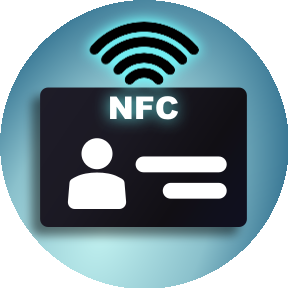 Share over NFC

- Turn on **send mode** and the phone becomes an NFC tag: hold it to another
  phone and your active item is read, exactly as from a physical NFC card.
- A **link** is the most widely readable choice. iPhones open links straight
  from a tap, so a link to a hosted `.vcf` gets your contact card onto an iPhone
  too. A **vCard** is shared directly, for Android readers.
- Send mode only works while the app is open and the phone is unlocked — the
  screen says so rather than pretending otherwise. A locked phone shares nothing.
- **Tap confirmation:** a flash, a sound or a vibration tells you the card was
  actually read, since the screen is usually facing away from you.

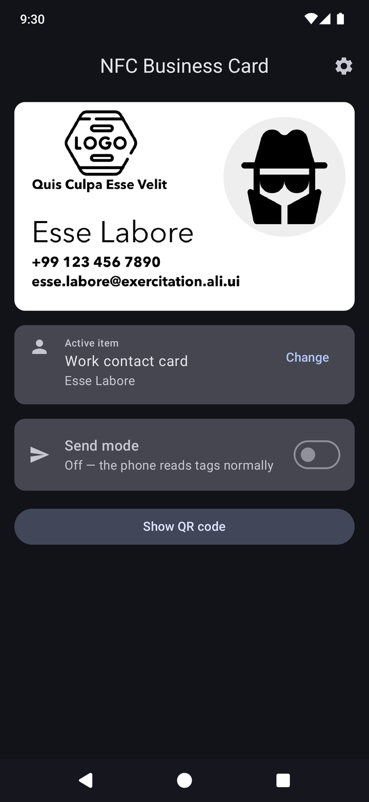 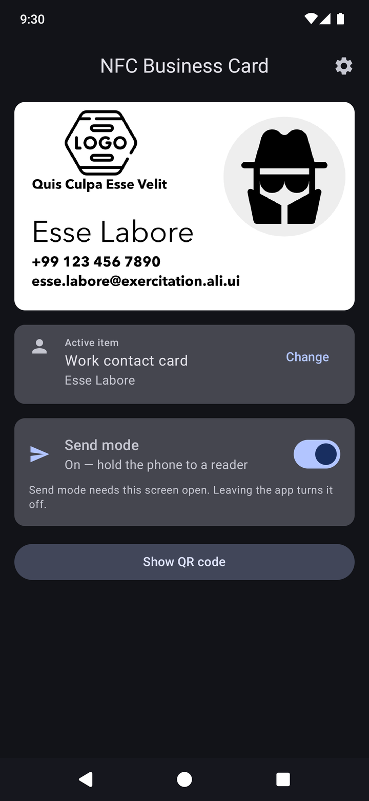

##  Show a QR code

- For anyone without NFC. Codes are generated on the phone from the active item,
  never stored.
- **Swipe between detail levels** — Link only, Minimal, Standard, Full. A sparse
  code has bigger squares and scans in poor light or from a weak camera; a dense
  one carries more. A link has just the one level.
- An on-screen **brightness** slider (full brightness by default), with the
  screen kept on while the code is showing.
- Photos are never put in a code. They make it unscannable.

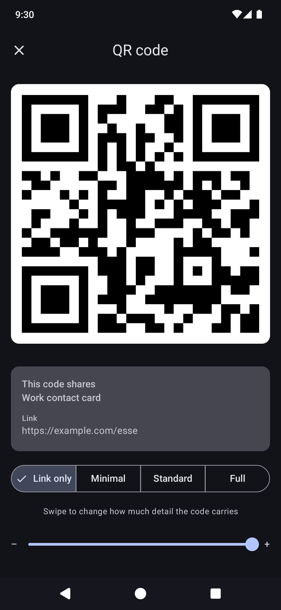 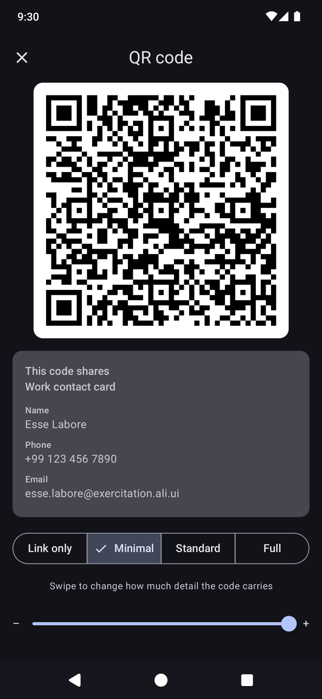

##  Show the card

- For people who just want to read the details. Use your own card artwork as a
  PNG, or let the app draw a card from your contact details.
- **Full card mode** fills the screen with the card turned to face the person
  you are showing it to. Tap it to turn it the other way. NFC and QR are one tap
  away at the bottom.
- A **home screen widget** shows the card with NFC and QR buttons. Resize it
  from 5x2 down to 3x2 and it drops the buttons to show just the card, which
  sits neatly alongside your app icons.

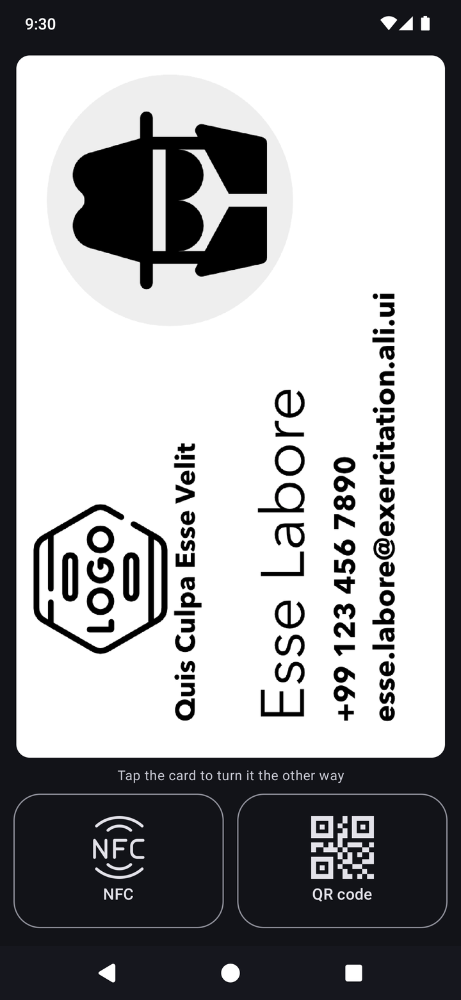 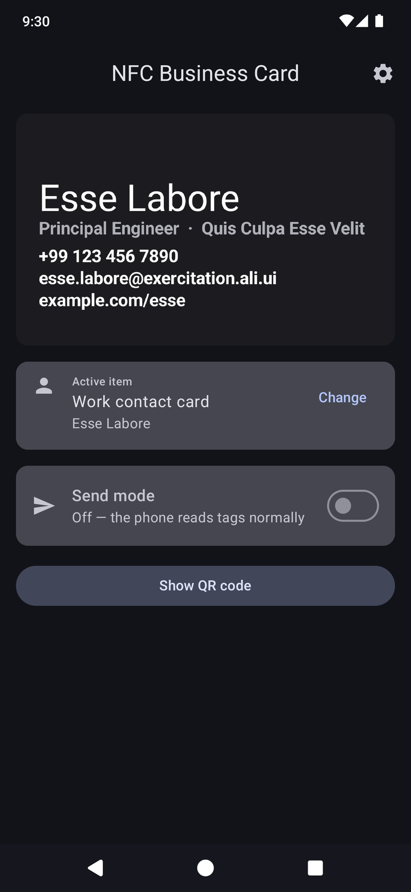 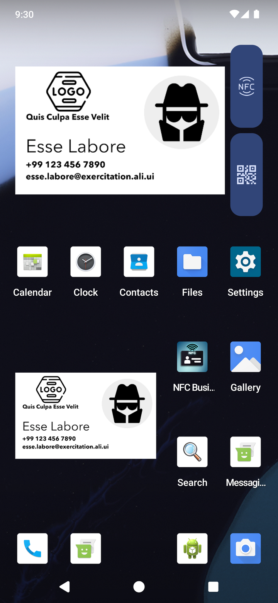

##  Your items

- Keep several **links** and **vCards** and pick which one is active from the
  main screen.
- Create a vCard field by field, **copy one from Contacts**, or **import a
  `.vcf` file**, including one shared from another app.
- Reorder, edit and delete. A photo on a vCard is shown in the app only and is
  never sent.
- **Settings** cover the card image and shape (Australian 90 × 55, ISO/CR80 or
  US), which detail level the QR code opens at, brightness, and tap
  confirmation.

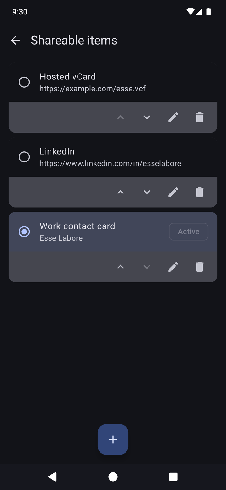 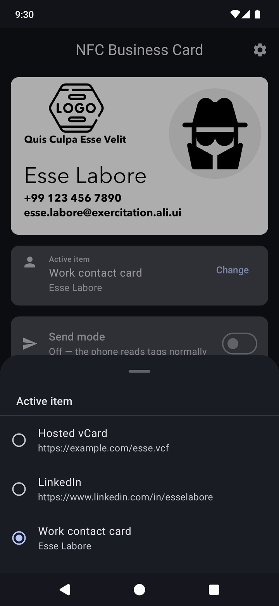 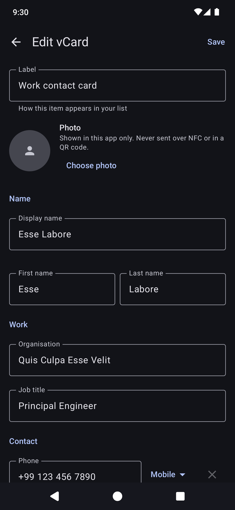 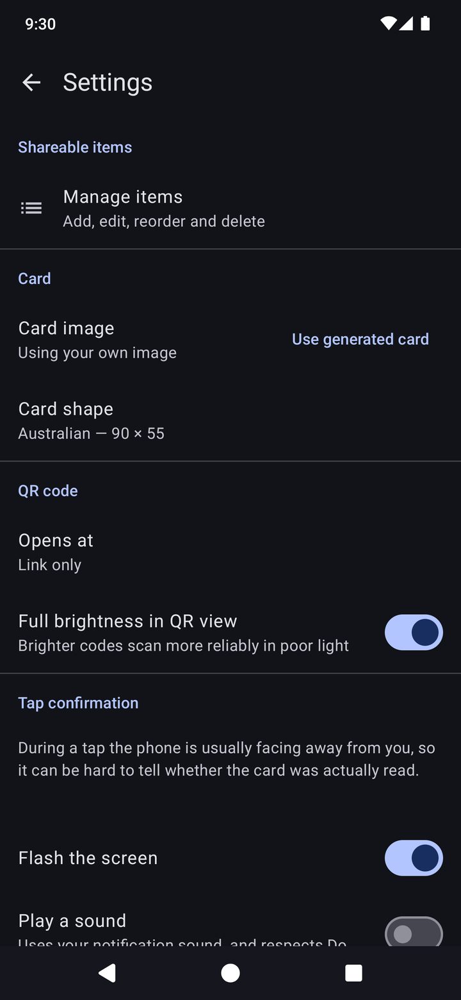

Screenshots show placeholder details and sample card artwork.

## Install

Releases are published on the
[releases page](https://github.com/snrkl-labs/NFCBusinessCard/releases) as a
signed APK.

### With Obtainium (recommended — gets updates)

1. Install [Obtainium](https://github.com/ImranR98/Obtainium).
2. **Add app**, and paste `https://github.com/snrkl-labs/NFCBusinessCard`.
3. Install. Obtainium checks this repository for new releases and offers each
   update as it is published.

### By hand

Download `NFCBusinessCard-vX.YY.ZZ.apk` from the latest release and open it.
Updates will not arrive by themselves.

### Verifying a download

Every release is signed with the same key. Its certificate SHA-256 is printed
in each release's notes and is:

```
D4:EA:8D:0B:24:B5:E1:60:1F:5A:FD:64:1A:16:3C:6B:70:93:D0:F7:4B:EB:85:AE:18:A8:B0:4A:56:33:35:3D
```

Android refuses an update signed by any other key, so once installed, a
substituted APK cannot replace it. To check a download before installing it,
compare that fingerprint against `apksigner verify --print-certs <apk>`, or use
[AppVerifier](https://github.com/soupslurpr/AppVerifier).

## Building

Requires JDK 17 and an Android SDK with platform 34.

```bash
./gradlew assembleDebug        # app/build/outputs/apk/debug/app-debug.apk
./gradlew assembleRelease      # minified, unsigned
./gradlew testDebugUnitTest    # unit tests
./gradlew lintDebug            # lint
```

`local.properties` must point at the SDK (`sdk.dir=...`). A build of your own is
signed with your own key, so it installs alongside nothing: remove a published
build before installing yours, and the other way round.

## What is and is not verified by the build

Everything that can be tested without an NFC radio is tested. The NDEF encoder,
the Type 4 APDU state machine, the vCard serialiser, the density-tier field
selection and the QR encoder are all pure Kotlin with no Android dependencies,
and all are covered by unit tests.

**Nothing touching the NFC radio can be verified by the build.** No emulator has
NFC hardware and there is no HCE path in an AVD, so NFC behaviour can only be
tested by hand on a physical phone.

## Card Face artwork

The card image region displays a PNG at exactly 1:1 on the target device. Export
artwork at:

| Card shape | Pixel dimensions | Displayed at |
|---|---|---|
| Australian 90 × 55 (default) | **1242 × 759** | 414 × 253 dp |
| ISO / CR80 85.6 × 54 | 1242 × 784 | 414 × 261 dp |
| US 3.5 × 2 in | 1242 × 710 | 414 × 237 dp |

These come from `buildSrc/src/main/kotlin/CardFaceSpec.kt`, which also generates
the placeholder images and the geometry constants the layout uses — so the
dimensions printed on a placeholder are always the real ones.

To get a reference copy of the placeholders:

```bash
./gradlew exportCardFacePlaceholder   # writes into assets/card-face/
```

## Licence

Apache License 2.0. See [LICENSE](LICENSE) and [NOTICE](NOTICE).

Apache 2.0 rather than MIT because the dependency stack — AndroidX, Jetpack
Compose, Room, Kotlin, ZXing, Coil — is almost entirely Apache 2.0, and because
it carries an explicit patent grant that MIT does not.

### Third-party assets

The application icon and the NFC and QR button icons are licensed stock artwork.
They are compiled into the APK under a paid licence held by the author. The
rasterised icons under `app/src/main/res/` are included so the project builds;
the editable source artwork is not redistributed. See NOTICE.
